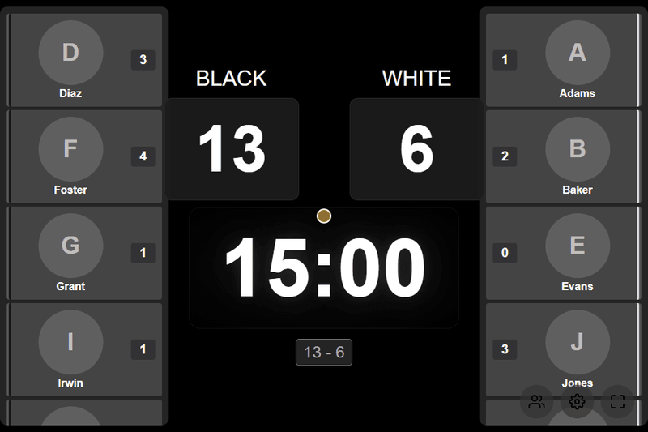

# Scoreboard

A basketball scoreboard for a weekly pickup game, built as a SharedTools module for ASP.NET Core. Every phone, tablet or laptop that opens it sees the same teams, score and history; the server stores everything in Azure Blob Storage.



## Overview

The scoreboard is a [SharedTools](https://github.com/andrewboudreau/SharedTools) 3.0 web module (`src/Scoreboard`). It ships as a **drop**: its `dotnet publish` output (assembly, dependencies and `wwwroot/`), zipped and uploaded to a module host, which loads it at startup. `src/Scoreboard.WebApp` is a minimal local host that loads the same drop.

- **Drop, not a package** - no NuGet publishing; `deploy.ps1` uploads a new version
- **Isolated** - the module's dependencies (Azure Blob, ImageSharp) load in their own context
- **Static files** - the host serves the drop's `wwwroot/` at `/_content/Scoreboard/`

## Features

- **Scoreboard** - tap to score, long-press to undo, countdown timer with buzzer, quarter scores, fullscreen, keep-screen-on
- **Player scoring** - tap a player to credit them and their team
- **Team-only games** - type in the score at the end of each quarter when nobody is tracking baskets
- **Teams panel** - one tap per player for BLACK / Out / WHITE, Balance (most even teams from past results) or Shuffle, pins, player photos, share the teams to the group chat
- **Shared across devices** - the server is the single source of truth; changes save automatically and retry when offline
- **Stats** - head-to-head record, streaks, comebacks, by-quarter averages, player table with game logs, game history
- **Insights** - player impact ratings (adjusted plus-minus from final scores, back-tested), next-game win prediction, best duos, rivalries, scoring styles, attendance, trends (`insights.js`)
- **Game pages** - score chart, box score, play-by-play, live follow-along while a game is in progress

There is no login: anyone with the URL can view and edit. It's meant for a private group of friends.

## Project Structure

```
Scoreboard/
├── src/
│   ├── Scoreboard/                 # The module (SharedTools.Scoreboard)
│   │   ├── ScoreboardModule.cs     # IApplicationPartModule: services, page routes
│   │   ├── ScoreboardApi.cs        # All /Scoreboard/api endpoints
│   │   ├── ScoreboardOptions.cs    # Modules:Scoreboard settings
│   │   ├── Services/
│   │   │   └── ScoreboardStore.cs  # Reads/writes JSON in the blob data folder
│   │   └── wwwroot/                # Static assets, published with the drop
│   │       ├── index.html, app.js, styles.css      # Scoreboard
│   │       ├── stats.html, game.html               # Stats dashboard, single game
│   │       ├── stats-core.js, stats.css            # Shared by the stats pages
│   │       ├── docs.html                           # User-facing docs
│   │       ├── default-players.json                # Seed roster for a fresh install
│   │       ├── audio/  icons/
│   │
│   └── Scoreboard.WebApp/          # Minimal host (Program.cs)
├── tests/Scoreboard.Tests.Playwright/  # End-to-end tests
└── docs/FRONTEND.md                # Frontend architecture
```

## Quick Start

### Prerequisites

- .NET 11 SDK
- Azure Storage account, or [Azurite](https://learn.microsoft.com/azure/storage/common/storage-use-azurite) locally

### Running locally

1. Start Azurite (blob endpoint on port 10000).
2. Run the host. Its build publishes the module to `src/Scoreboard.WebApp/bin/drops/scoreboard`, which it loads through `Modules:Paths:scoreboard`:
   ```bash
   dotnet run --project src/Scoreboard.WebApp/Scoreboard.WebApp.csproj
   ```
3. Open http://localhost:5227/Scoreboard/ (module hub: http://localhost:5227/_modules)

Changes to `src/Scoreboard` need a host restart (`dotnet run` rebuilds and republishes the drop).

## Configuration

The module reads its own section, `Modules:Scoreboard` (environment: `Modules__Scoreboard__ConnectionString`, ...). In the host's `appsettings.json`:

```json
{
  "Modules": {
    "Scoreboard": {
      "ConnectionString": "UseDevelopmentStorage=true",
      "ContainerName": "scoreboard-data",
      "DataFolder": "main"
    }
  }
}
```

- `ConnectionString` and `ContainerName` are required. The old root `BlobStorage:ConnectionString` / `ContainerName` / `DataFolder` keys still work as a fallback.
- `DataFolder` (optional) is the folder inside the container that holds all data. If unset, the module uses the folder of the old group with the most games (so history from earlier versions carries over), or `main` on a fresh install. `GET /Scoreboard/api/info` shows which folder is in use.

### Storage layout

```text
{container}/{dataFolder}/
├── roster.json          # { team1Name, team2Name, players: [...] }
├── current-game.json    # { gameId }
├── games/{gameId}.json  # full game: scores, quarters, players, events
└── players/{id}.png     # 96x96 player photos
```

## API

All under `/Scoreboard/api`. JSON bodies are capped at 1 MB; game ids must match `[A-Za-z0-9_-]{1,80}`.

| Method | Path | Description |
|--------|------|-------------|
| GET | `/info` | Version, data folder, game count, whether a roster exists |
| GET | `/roster` | Roster; on a fresh install, the bundled default players with `seeded: true` |
| PUT | `/roster` | Replace the roster |
| GET | `/current-game` | The current game document, or 204 if none |
| PUT | `/current-game` | Set the pointer: `{ "gameId": "..." }` |
| GET | `/games` | Every saved game, as one JSON array |
| GET | `/games/{id}` | One game (404 if missing) |
| PUT | `/games/{id}` | Save a game |
| POST | `/players/{id}/image` | Upload a photo (multipart field `image`, max 10 MB); center-cropped to 96x96 PNG. Returns `{ imageUrl }` |
| GET | `/players/{id}/image` | Player photo (PNG) |

Pages: `/Scoreboard/` (scoreboard), `/Scoreboard/stats`, `/Scoreboard/game?id={gameId}`, `/Scoreboard/docs`.

## Development

### Module architecture

1. **`ScoreboardModule.cs`** implements `IApplicationPartModule`: registers the `BlobContainerClient` and `ScoreboardStore`, maps the HTML pages and calls `ScoreboardApi.Map`. Pages are read from the drop's `wwwroot/` and `{{v}}` is replaced with a per-build id so browsers pick up new scripts.
2. **`ScoreboardApi.cs`** is the whole API. The server stores JSON documents the browser sends; game logic lives in the browser.
3. **`wwwroot/`** is published with the drop; the host serves it from `/_content/Scoreboard/`.

See [docs/FRONTEND.md](docs/FRONTEND.md) for the client side.

### Host

```csharp
// src/Scoreboard.WebApp/Program.cs
await builder.AddApplicationPartModules([
    "SharedTools.Scoreboard",
    "SharedTools.ModuleManagement"
]);
var app = builder.Build();
app.UseApplicationPartModules();
```

### Tests

Playwright end-to-end tests in `tests/Scoreboard.Tests.Playwright/`. The host must be running; the tests intercept `/Scoreboard/api/**` with an in-memory fake, so they never touch real storage.

```bash
dotnet test
cmd /c "set HEADED=1 && dotnet test"          # visible browser
set SCOREBOARD_BASE_URL=http://localhost:5227  # different host
```

## Deploying

- Pushes to `master` bump the patch version in `Directory.Build.props` (`ci.yml`); `/Scoreboard/api/info` reports it.
- `./deploy.ps1` publishes `src/Scoreboard` to `out/`, zips it, uploads it to the module host (default https://modules.blogfor.net, id `scoreboard`) and waits until the host reports the drop as loaded. A drop that fails to load is rolled back to the previous one.
- The upload key is `MODULE_UPLOAD_KEY`, from the environment or a gitignored `.env` at the repo root. It lets the holder run code on the host: never commit or share it.
- The module is no longer published to NuGet.org.

## Integration

To host the module in another ASP.NET Core app (SharedTools.Web 3.x), call `builder.AddModules()` and `app.UseModules()`, point `Modules:Paths:scoreboard` at a published drop (or upload it to the host's module store), and configure `Modules:Scoreboard` as above.

## License

MIT - see [LICENSE.txt](LICENSE.txt).

## Related Documentation

- [Frontend Architecture](docs/FRONTEND.md)
- [SharedTools](https://github.com/andrewboudreau/SharedTools) - module drops and hosting
- [CLAUDE.md](CLAUDE.md) - build commands and workflow
